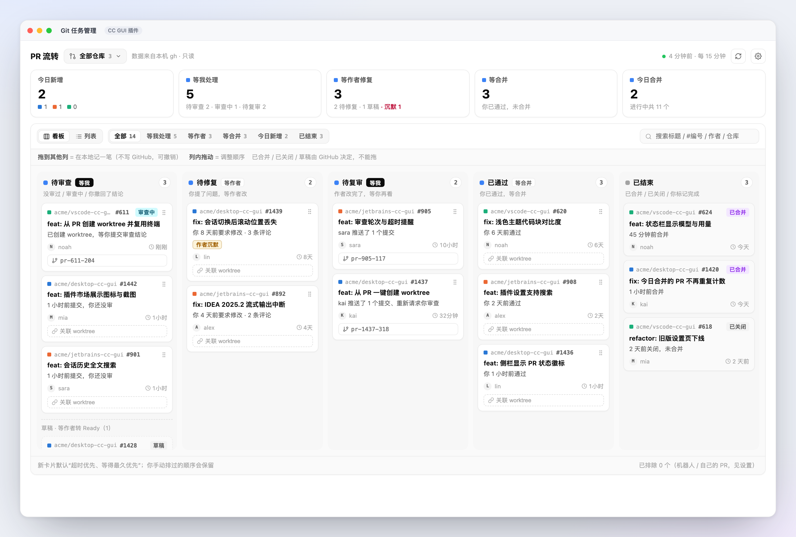
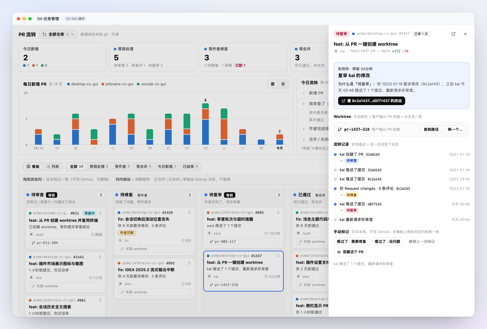
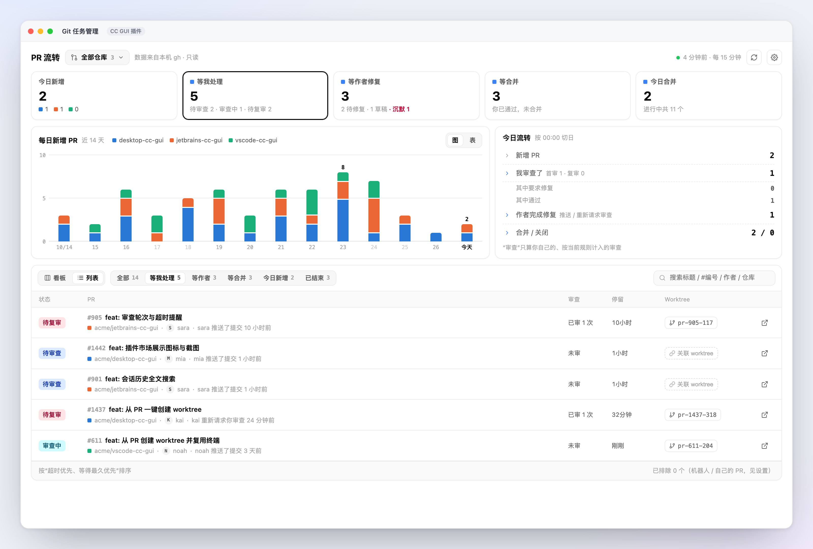
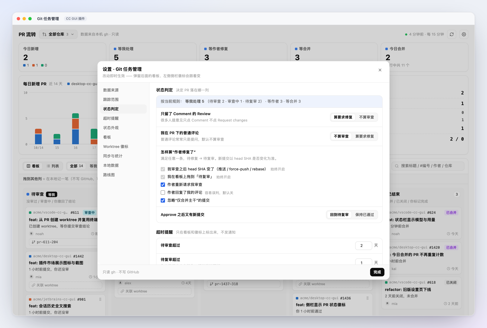

# CCGUI · Git 任务管理（github-tasks）

轻量、只读的 PR 流转看板：回答“每个 PR 现在球在谁手里”。

- 「审查中」：PR 有对应 worktree（从 PR 新建或手动绑定）且你还没提交审查结论时自动进入；
  提交结论或解绑/删除 worktree 后退出。归在「待审查」列、排在最前，徽标显示「审查中」。
- 多仓库每日新增（按仓库分色堆叠柱，附「表」视图）
- 我审没审 → 要不要作者修 → 作者修没修 → 修完我看没看
- 看板五列 + 跨列拖拽（只记本地标记，5 秒可撤销）/ 列表视图
- 详情抽屉：为什么是这个状态、流转记录、手动标记、worktree 关联
- 在 GitHub 手动合并后不必等定时同步：抽屉右上角和「等合并」卡片上都有**刷新状态**，
  按 PR 编号直连 GitHub 读取真实状态（合并 / 关闭立即生效）
- 侧栏 worktree 行显示 PR 状态徽标（通过宿主通用扩展点 `ui:worktree-badge`）

只调用本机 `gh` CLI 的只读子命令。不调用 AI、不自动评论 / 批准 / 合并、不发通知、不写 GitHub。

## 界面预览

| 五列看板：每个 PR 球在谁手里 | PR 详情：为什么是这个状态 |
|---|---|
| [](docs/screenshot-1.png) | [](docs/screenshot-2.png) |

| 列表视图 + 今日流转 | 状态判定规则可调 |
|---|---|
| [](docs/screenshot-3.png) | [](docs/screenshot-4.png) |

素材由 `npm run assets` 从当前 `src/ui` 真实组件渲染（jsdom → Chrome 2x 截图），
数据是 `acme/*` 固定夹具，不含真实账号与评论。

## 安装

```bash
npm install
npm run build          # src/ → main.js（单文件 ESM）
```

客户端「设置 › 插件 › 从本地目录安装」选择本目录。宿主需要 SDK ≥ 0.3.22（本插件用
`ui:worktree-badge` 与 `registerSidebarNav.badge`）。开发时改完 `src/` 重新 `npm run build`
并重新安装即可热重载。

原生窗口打开插件时，同名的旧插件 `git-tasks` 不应同时启用（两者入口都叫「Git 任务管理」）。
本插件不读写旧插件的数据。

## 发布到插件市场

1. 公开仓库根目录必须有 `manifest.json`、`README.md`、`LICENSE` 与
   `.github/workflows/release.yml`（本仓库已就位；`dist/` 由构建生成、不入库）。
2. `manifest.json` 已声明 `"repo": "zhukunpenglinyutong/ccgui-plugin-git-tasks"` 与 `"license": "MIT"`；
   `icon`（`docs/icon.png`）与 4 张 `screenshots` 也已声明，市场读取默认分支上的文件。
3. 升 `version`（semver），提交后打**与 version 完全一致、无 `v` 前缀**的 tag：
   `git tag 1.0.0 && git push origin 1.0.0`。Release Action 会构建并附加
   `main.js` / `manifest.json` / `styles.css` / `checksums.txt`。
4. 首次上架：向索引仓 `ccgui-plugins` 提 PR（`community-plugins.json` +
   `plugins/<id>.json`，sha256 抄 Release 的 `checksums.txt`）。索引 CI 会下载
   Release 产物复核版本、体积、权限与黑名单。
5. 之后更新只需发新 tag；索引机器人会轮询并自动登记（新增权限转人工）。

市场索引当前（SDK 0.3.22）已支持 `ui:worktree-badge`；宿主需要先发一个包含
SDK 0.3.22 的版本，`minAppVersion` 填那个版本号。

## 权限与理由

| 权限 | 用途 |
|---|---|
| `ui:center-tab` | 中心页签「Git 任务管理」 |
| `ui:sidebar-entry` | 侧栏入口 + 等我处理计数 |
| `ui:settings-section` | 同一份设置在「客户端设置 › 插件」里 |
| `ui:command` | 命令面板：打开面板 / 立即同步 |
| `ui:worktree-badge` | 把 PR 状态推到 worktree 行；只推文字、颜色、纯文本 tooltip |
| `storage` | 保存设置、每个仓库的归一化快照、本地标记 / 绑定 / 排序 / 忽略 |
| `host:workspace` | 读取工作区与 worktree 子行（解析仓库、对应 PR）；徽标 `list/onChange` 也要求它 |
| `host:worktree` | 「从 PR 新建 worktree」走宿主同一条创建管线；删除也走宿主管线 |
| `exec:gh` | 读 PR / Review / 提交 / 时间线；只允许 `api graphql`（拒绝 mutation）、`api user`、`pr list`、`auth status` |
| `exec:git` | 只允许 `git -C <path> remote get-url <origin\|upstream>`，把工作区映射到 GitHub 仓库 |
| `exec:open` / `exec:xdg-open` / `exec:cmd` | 在系统浏览器打开 GitHub 链接；只接受 `https://github.com/…` |

不申请 `network:*`：所有网络访问都由 `gh` 自己完成。插件存储里不放 token、完整评论正文或 diff。

## 实现备注

- **数据量**：宿主 `plugin_exec_run` 每路输出上限 64KB。GraphQL 结果用 `--jq` 投影成紧凑数组，
  列表每页 50，详情按 4 个 PR 一批（commits 60 / timeline 80）；详情只对新增或
  `headSha / updatedAt` 变化的 PR 重拉。批量详情失败会逐个重试，单个坏 PR 不影响其他 PR。
  `gh` 进程默认**串行**（本机链路在 4 路并发时实测会 `EOF`）；只读请求遇到 EOF/连接重置
  自动退避重试 2 次，限流重试 1 次。已结束列表与每日统计 30 分钟内复用上一轮。稳态每仓库
  每次约 1–2 次 gh 调用（首次同步会多很多）。
- **同步进度**：头部显示 `同步中 · 2/4 仓库 · 37s`；单仓库失败在结束后进入错误横幅，可重试。
- **合并后立即生效**：`gh pr list --search` 走 GitHub 搜索索引，刚合并的 PR 可能几分钟内还查不到。
  因此从 open 列表消失的 PR 会按编号直查一次真实状态（`state / mergedAt / closedAt`），
  抽屉里的「刷新状态」也走同一条查询；30 分钟的已结束列表缓存只影响批量拉取，不再拖延
  单个 PR 的合并 / 关闭状态。查询失败时保留上一轮数据，PR 不会从看板消失。
- **状态以 SHA 为准**：作者是否修复 = 我上次审查绑定的 commit SHA ≠ 当前 head SHA。rebase /
  force-push 也能识别；只有 `commitShas` 窗口（最近 100 个）外的旧 SHA 会退化为“视为新代码”，
  对“待复审”的判断不变，只可能让“忽略仅合并主干”在极端长历史下失效。
- **已结束的 PR** 只取近 `endedDays` 天的合并 / 关闭，且不额外拉审查记录；因此「表」视图里
  更早日期的“我审查 / 作者修复”可能偏低（这些历史不在同步范围内）。
- **worktree 的「打开」**：宿主目前没有让插件切换/聚焦工作区的 API，看板与详情里的 worktree
  按钮是「复制路径」，侧栏仍由客户端的 worktree 行负责打开。
- **滚动位置**：面板主体（按视图各一份）与看板每列各记住滚动位置。新建 / 关联 worktree 会
  触发 `index.refresh()` 回写仓库与 worktree，宿主的进度行 / 工作区刷新又会让面板重挂；两种
  情况下滚动容器都会被浏览器钳回 0（内容高度短暂塌陷或节点重建），用户刚才滚到哪儿就丢了。
  `src/ui/scroll.js` 把位置存在内存 + `sessionStorage`，重挂后恢复，塌陷造成的钳位不覆盖旧值
  （用户的滚轮 / 触摸 / 拖滚动条 / 键盘仍然优先）。
- 拖拽只写本地标记；不会写 GitHub。标记完成（done）在作者之后有新推送 / 重新请求审查时自动失效。
- 状态名、颜色、是否上侧栏都可在设置里改；默认名称中文，英文环境首次启动自动换成英文默认名。

## 开发

```bash
npm test                                   # node:test（领域 / 数据层 / UI 冒烟 / 激活集成）
npm run coverage                           # 行覆盖；src/domain 与 gh/normalize 目标 ≥ 90%
node scripts/build.mjs                     # 或 npm run build
```

- `src/domain/*` 是纯函数（状态推算、拖拽规则、统计、文案），测试先于实现。
- `src/gh/*` 负责只读执行、查询与归一化；`tests/fixtures/` 是从真实仓库抓取的紧凑样例。
- `src/ui/*` 只使用宿主注入的 `ctx.react` 与公开 token；样式前缀 `.ght-`，暗色靠 token 翻转。
- `main.js` 是构建产物，不要手改。

## 路线图（设置 › 路线图 同款）

尚未实现、也不会提前申请权限：

- **GitLab 支持**（规划中）：用 glab 读取 MR 审查 / 批准 / 提交，复用同一看板；需先定 gitlab.com / 自建实例与 MR 审查语义映射。
- **AI 自动审查**（规划中）：只读 AI 预审建议，不自动提交审查。
- 自动评论 / 批准 / 合并（后续，需显式授权，默认关）
- 飞书 / 系统通知（后续）
- 拖拽直接写 GitHub（后续；当前只记本地标记）
- Issue 看板（后续）

## 已知限制

- 侧栏徽标的文字由宿主截到 6 个字符；停留时长后缀较长时会被截断。
- HTML5 拖拽只在宿主 webview 里验证过（真实应用验收），不在浏览器里模拟。
- gh 限流只自动重试一次（退避 1.5s），之后在面板头提示并可手动重试。
- 只支持 github.com（不支持 GitHub Enterprise 的自定义域名）。
